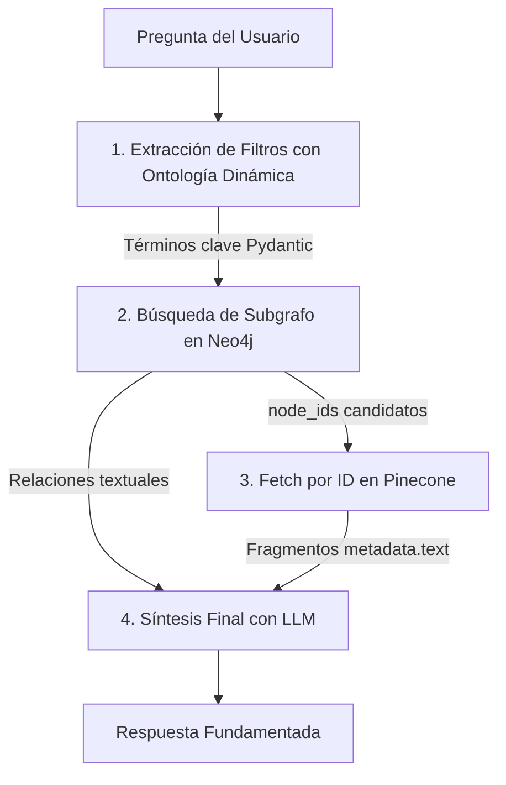

# Graph-to-Vector RAG Pipeline (Neo4j + Pinecone)

Pipeline de consulta híbrida **GraphRAG** implementado en Python con **LangChain**, **Pydantic**, **Neo4j** y **Pinecone**. 

A diferencia de un RAG vectorial tradicional, este sistema sigue un flujo **Graph-to-Vector**: inspecciona dinámicamente la ontología de la base de datos de grafos, extrae términos clave de la pregunta del usuario, recupera subgrafos relevantes en **Neo4j**, utiliza los `ID` de las entidades resultantes para recuperar fragmentos textuales exactos en **Pinecone** mediante `fetch`, y sintetiza una respuesta fundamentada combinando relaciones estructurales y contexto documental.

---

## Arquitectura del Pipeline

El flujo de ejecución en `GraphRAGAutonomo` (`busqueda_graphrag_autonomo.py`) consta de cuatro etapas principales:



1. **Inspección Ontológica y Enrutamiento (`_obtener_esquema_ontologico_dinamico` & `_extractor_filtros_desde_pregunta`):**
   * Al inicializar, el sistema consulta Neo4j (`db.labels()`, `db.relationshipTypes()` y claves de propiedades de nodos y relaciones) para construir el esquema real del grafo.
   * Inyecta dicho esquema en el *system prompt* de `gpt-4o-mini` con salida estructurada (`FiltrosConsultaGraphRAG`) para extraer únicamente términos clave alineados con la ontología existente.
2. **Recuperación de Subgrafo en Neo4j (`_obtener_subgrafo_y_node_ids`):**
   * Ejecuta una consulta Cypher sobre nodos `:Entidad` buscando coincidencias parciales insensibles a mayúsculas en `nombre`, propiedades de nodos y propiedades de relaciones (`LIMIT 50`).
   * Extrae tanto la representación legible de las tripletas `(Origen)-[RELACION]->(Destino)` como el conjunto único de `node_ids` asociados.
3. **Recuperación Vectorial Filtrada por ID en Pinecone (`_bucar_en_pinecone`):**
   * Realiza una operación `index.fetch(ids=node_ids)` directamente sobre el índice de Pinecone usando los identificadores validados por el grafo.
   * Extrae y deduplica el contenido textual almacenado en `metadata["text"]`.
4. **Síntesis Fundamentada (`ejecutar_pipeline`):**
   * Combina la estructura del grafo y los fragmentos de texto recuperados en un prompt estricto que instruye al LLM a responder exclusivamente con base en el contexto obtenido, evitando alucinaciones.

---

## Estructura del Proyecto

```text
graph-to-vector-rag-pipeline-neo4j-pinecone/
├── busqueda_graphrag_autonomo.py   # Clase principal GraphRAGAutonomo y lógica del pipeline
├── main.py                         # Script de entrada con ejemplos de consultas
├── environment.yml                 # Definición del entorno Conda y dependencias
├── .env                            # Variables de entorno (no versionado)
└── README.md                       # Documentación del proyecto
```

---

## Requisitos Previos

* **Python 3.13+** (o gestión mediante **Conda** / **Miniconda**).
* Una instancia activa de **Neo4j** (local o AuraDB) con nodos etiquetados como `:Entidad` que contengan al menos las propiedades `id` y `nombre`.
* Un índice activo en **Pinecone** donde los IDs de los vectores coincidan con los `id` de los nodos en Neo4j y contengan el texto original en el campo de metadatos `text`.
* Una clave de API válida de **OpenAI**.

---

## Instalación

1. **Clonar el repositorio:**
   ```bash
   git clone https://github.com/DiegoAlejandroLozano/graph-to-vector-rag-pipeline-neo4j-pinecone.git
   cd graph-to-vector-rag-pipeline-neo4j-pinecone
   ```

2. **Crear y activar el entorno Conda:**
   ```bash
   conda env create -f environment.yml
   conda activate conda-graphrag-curso
   ```

---

## Configuración

Crea un archivo `.env` en la raíz del proyecto con tus credenciales de acceso:

```env
# OpenAI
OPENAI_API_KEY=sk-...

# Neo4j
NEO4J_URI=bolt://localhost:7687
NEO4J_USER=neo4j
NEO4J_PASSWORD=tu_password

# Pinecone
PINECONE_API_KEY=pcsk_...
PINECONE_INDEX_NAME=knowledge-graph
```

---

## Uso

Ejecuta el script principal `main.py` para probar el pipeline con consultas de ejemplo:

```bash
python main.py
```

### Ejemplo de integración en código

```python
from busqueda_graphrag_autonomo import GraphRAGAutonomo

app = GraphRAGAutonomo()

try:
    respuesta = app.ejecutar_pipeline(
        "¿Quién creó el Django REST Framework y para qué sirve?"
    )
    print(respuesta)
finally:
    app.cerrar()
```

### Salida esperada en consola

```text
[1. Ontologia/Filtros] Analizando pregunta: '¿Quién creó el Django REST Framework y para qué sirve?'
-> Términos: ['Django REST Framework']
[2. Neo4j Subgrafo] Nodos candidatos recuperados: 4
[3. Pinecone Vectorial] Registros recuperados: 4

=== RESPUESTA 1 ===
...
```

---

## Tecnologías Utilizadas

* **[LangChain](https://www.langchain.com/)** (`langchain-core`, `langchain-openai`) — Orquestación de prompts y salidas estructuradas.
* **[OpenAI](https://platform.openai.com/)** (`gpt-4o-mini`, `text-embedding-3-small`) — Extracción de entidades y síntesis de respuestas.
* **[Neo4j Python Driver](https://neo4j.com/docs/python-manual/current/)** — Inspección dinámica de ontología y consultas Cypher de subgrafos.
* **[Pinecone](https://www.pinecone.io/)** — Recuperación directa de fragmentos documentales mediante IDs de entidad (`fetch`).
* **[Pydantic v2](https://docs.pydantic.dev/)** — Validación de esquemas para el enrutador de consultas.